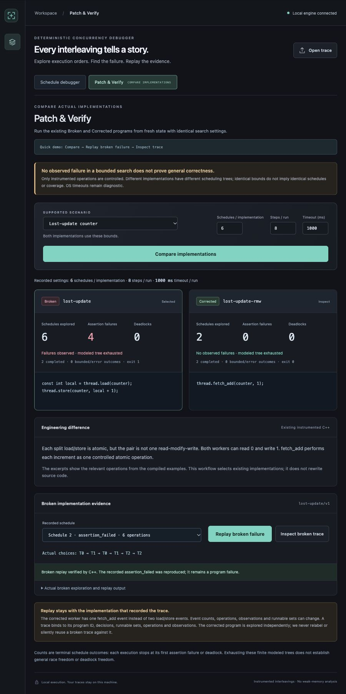
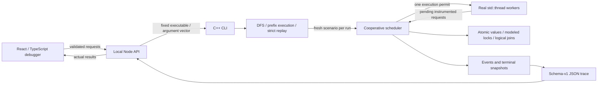
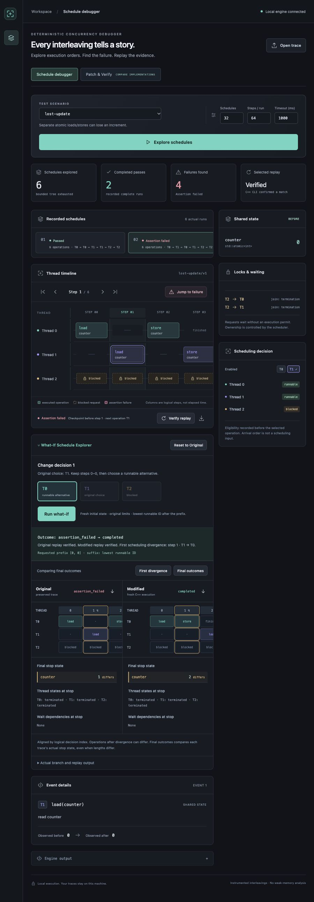

# ThreadScope

**Find a concurrency failure, replay the evidence, and change one scheduling decision.**

ThreadScope is a C++20 concurrency-testing engine with a React/TypeScript visual
debugger. Real native workers submit explicitly instrumented operations to a
cooperative scheduler. Bounded depth-first exploration finds lost updates and
modeled deadlocks; structured JSON traces make those failures inspectable and
replayable.

Timing-dependent bugs are difficult to reproduce with stress tests alone.
ThreadScope makes the execution order an explicit input, so a small concurrent
algorithm can be examined one decision at a time.

> **Guarantee:** deterministic scheduling applies to instrumented operations in
> supported programs with deterministic, bounded local computation. It does not
> apply to arbitrary unmodified binaries, uncontrolled shared-state access, or
> weak-memory effects. Finding no failure in a bounded search does not prove
> general correctness. Wall-clock timeouts remain environmental diagnostics.



## What works

- **Explore:** ascending-ID DFS of valid runnable choices, with schedule, step,
  and cooperative time bounds; every run starts from fresh scenario state.
- **Replay:** validate runnable sets, operation metadata, observations, resource
  snapshots, dependencies, and terminal outcome. Divergence is an explicit error.
- **What-If Schedule Explorer:** preserve an original trace, choose an alternative
  enabled thread, execute its prefix from fresh state, and compare two real,
  replay-verified histories. The suffix chooses the lowest runnable ID.
- **Patch & Verify:** compare compiled Broken/Corrected implementations under
  identical bounds, report assertion/deadlock counts separately, and replay a
  broken failure in its original program. No source rewriting occurs.
- **Inspect:** timelines, before/after shared state, lock owners, waiting
  dependencies, event details, and explicit bounded/error states.

## Architecture



Before each choice, the driver waits until **every** worker has posted its next
request or terminated. Native arrival order cannot determine the runnable set.
One selected worker executes a bounded built-in operation under the scheduler
monitor, records observations, and continues local work. The next decision waits
for quiescence again. A context verifies that its registered native worker is
the caller.

The monitor protects requests, grants, state transitions, and history. Shared
counter operations use real atomics, so the deliberately broken load/store
example has no undefined C++ data race. Modeled locks never acquire a native
application mutex while holding a permit: unavailable acquisitions stay blocked
as pending requests. A stopped trace captures state **before** cancellation;
cleanup wakes waiters and joins every launched worker.

The engine has no dependency on the web stack. See [architecture](docs/architecture.md)
and [trace schema and validation](docs/trace-format.md).

## Install, build, and launch

Requirements: CMake 3.20+, a C++20 Clang/GCC compiler and native thread support.
The pinned JSON header is vendored; the engine builds offline. The debugger
requires Node 22.12+ and npm. Python 3.9+ runs the benchmark and its optional CTest
regression. Local verification used macOS arm64 and AppleClang 17; other platforms
are not verified by this local audit.

From a checkout:

```sh
cmake -S . -B build -DCMAKE_BUILD_TYPE=Debug -DTHREADSCOPE_WARNINGS_AS_ERRORS=ON
cmake --build build --parallel 4
ctest --test-dir build --output-on-failure
cd web
npm ci
npm run build
npm test
npm start
```

Open [http://127.0.0.1:4318](http://127.0.0.1:4318). For development, use
`npm run dev` and [http://127.0.0.1:5173](http://127.0.0.1:5173).
The API binds to `127.0.0.1`, uses only `build/threadscope`, accepts registered
scenario names and bounded integers, and spawns without a shell. It rejects
executable paths, commands, foreign hosts/origins, ambiguous JSON, and oversized
input. Each execution job has a process watchdog and isolated temporary files.
See [local API contract](docs/web-debugger.md).

## A 60–90 second demo

Build and start the server beforehand. The following uses live C++ runs:

1. **0–20 seconds:** open **Patch & Verify**, leave Lost-update counter and the
   presets (6 schedules, 8 steps, 1000 ms). Click **Compare implementations**.
   Broken reports 6 schedules / 4 assertions; Corrected reports 2 / 0.
   Click **Replay broken failure** and show the explicit verification result.
2. **20–55 seconds:** click **Inspect broken trace**. Select the thread-1 `load`
   at decision **1** (indices start at zero). Choose **T0** in What-If and click
   **Run what-if**, then **Final outcomes**. The preserved failure ends at
   counter 1; the new passing execution ends at 2. Both are replay-verified.
3. **55–85 seconds:** reset to the original, return to **Patch & Verify**, select
   Lock-order deadlock and compare. Broken has 2 deadlocks in 6 schedules;
   Corrected has none in 2. Replay and inspect a broken trace to show opposing
   owners and the wait-for cycle. Explain the prominent bounded-search limitation.

The What-If view was captured after actual branch execution and replay;
timeline columns represent logical decisions, not elapsed time.



To record a GIF/video, follow that sequence with a screen recorder, keep the
limits and replay badges visible, and include the bounded-search disclaimer.
Keep errors/loading visible when they occur. Checked-in screenshots are actual
browser captures; no synthetic outcome or GIF is supplied.

## Independent CLI

```sh
./build/threadscope run lost-update --schedule 0,1,0,1 --trace artifacts/failing.json
./build/threadscope replay artifacts/failing.json
./build/threadscope branch artifacts/failing.json --step 1 --thread 0 --trace artifacts/modified.json
./build/threadscope replay artifacts/modified.json
./build/threadscope explore mutex-deadlock --max-schedules 100 --max-steps 8 --out artifacts/locks
./build/threadscope explore mutex-ordered --max-schedules 100 --max-steps 8
```

Run these separately: a found or replayed assertion/deadlock intentionally exits
**1**. Exit **0** means completed/no observed failure; **2** means invalid input,
divergence, environmental error, or incomplete exploration. `--all-traces` saves
all executions as `schedule-N.json`; failures are also saved as `failure-N.json`.
Use a fresh output directory: numbered files can be overwritten and old extra
files are not removed.

An explicit `run --schedule` prefix must select runnable threads. Execution then
uses the lowest runnable ID. Exact replay permits no fallback; unused/missing
decisions and changed events are rejected. Branch output cannot overwrite its
original, including through symlinks or hard links. Broken and Corrected traces
may have different operations and runnable sets, so they are explored separately.

`--max-schedules` bounds complete/failing/deadlocked/step-bounded executions, not
DFS nodes. `--max-steps` bounds executed operations per run. An exhausted bounded
frontier can still contain unfinished step-limited runs; that is incomplete.
See [CLI scenarios](docs/scenarios.md), [What-If](docs/what-if.md), and
[Patch & Verify](docs/patch-verify.md).

## Measured results

Actual local measurements: **2026-10-13 01:49 UTC** (October 12 EDT),
macOS/Darwin 25.6.0, arm64, AppleClang 17.0.0, CMake Release, strict warnings,
no sanitizer. Each scenario ran 10 measured searches after one warmup, with
100 schedules / 8 steps / 5000 ms.

| Program | Schedules / search | Assertions / search | Deadlocks / search | Median exploration time |
| --- | ---: | ---: | ---: | ---: |
| Separate atomic load/store | 6 | 4 | 0 | 0.734 ms |
| Atomic `fetch_add` | 2 | 0 | 0 | 0.174 ms |
| Opposite lock order | 6 | 0 | 2 | 0.598 ms |
| Consistent lock order | 2 | 0 | 0 | 0.223 ms |

Across **160 actual schedules**, the two seeded logical fault classes were
discovered: split-atomic increment and opposite lock order. Multiple failing
schedules count as separate paths, not separate bugs. All trace sets were
byte-identical across the 10 trials. Each failing trace was independently replayed
5 times: **300/300 verified**, requiring both the exact verification marker and
the expected failure exit code.

Exploration time uses in-process `steady_clock` and includes DFS, fresh resources,
thread creation/joining, controlled operations, snapshots, and in-memory histories.
It excludes process startup, JSON encoding, and disk writes.

The single-run corrected-counter baseline uses the same three-native-worker
counter/checker behavior with direct atomics and native joins. After five warmups
per mode, 100 alternating native/controlled samples measured medians of **40.375 µs**
and **78.750 µs**: **1.950× runtime, 95.0% overhead**. This tiny workload includes
thread creation and compares the cost of scheduling/tracing a single run. It does
not measure whole-search overhead or establish performance on larger programs.

Reproduce and retain your own report:

```sh
cmake -S . -B build-audit-release -DCMAKE_BUILD_TYPE=Release -DTHREADSCOPE_WARNINGS_AS_ERRORS=ON
cmake --build build-audit-release --parallel 4
python3 scripts/benchmark.py --build-dir build-audit-release --output artifacts/benchmark.json --trials 10 --replay-trials 5 --baseline-samples 100
```

The [raw measured report](docs/benchmarks/macos-arm64.json) includes every duration,
replay result, build settings, source hashes, and binary hashes. It records a dirty
working tree: the commit ID alone does not identify the measured implementation.
See [methodology](docs/benchmark.md) for bounds, definitions, and limitations.

## Verification and audit

- **Debug + Release:** all 8 CTest suites passed with `-Wall -Wextra -Wpedantic
  -Wconversion -Wshadow -Werror`. Suites include 29 scheduler cases, 14 exploration
  cases, 13 scenario cases, isolated exception/allocation regressions, CLI
  integration, an independent runtime smoke test, and a benchmark regression.
  The benchmark suite is registered when Python and the harness are available.
- **Web:** strict TypeScript/Vite build and all **69** frontend/API tests passed.
  Integration tests invoke the real C++ executable; lifecycle unit tests explicitly
  model kill/close/error behavior without producing execution outcomes.
- **Standalone UBSan:** all 8 CTest suites passed with nonrecovering undefined
  behavior checks.
- **ASan + UBSan / separate TSan:** both configurations compiled. ASan startup
  probes timed out; TSan probes exited with SIGSEGV. The independent atomic/thread
  smoke binary failed the same way outside the sandbox. Full scans are **unverified**;
  no scheduler sanitizer finding or clean scan is claimed. Root cause is unresolved.
- Linux/macOS CI jobs are configured, including separate Linux sanitizer jobs.
  This local audit did **not** execute GitHub Actions or Windows builds.

Separate sanitizer commands (the probe script returns nonzero on failure):

```sh
cmake -S . -B build-audit-ubsan -DCMAKE_BUILD_TYPE=Debug -DTHREADSCOPE_SANITIZER=undefined
cmake --build build-audit-ubsan --parallel 4
python3 scripts/verify_sanitizer.py --build-dir build-audit-ubsan --report artifacts/audit/ubsan.json

cmake -S . -B build-audit-asan -DCMAKE_BUILD_TYPE=Debug -DTHREADSCOPE_SANITIZER=address
cmake --build build-audit-asan --parallel 4
python3 scripts/verify_sanitizer.py --build-dir build-audit-asan --report artifacts/audit/asan.json --probe-timeout 10

cmake -S . -B build-audit-tsan -DCMAKE_BUILD_TYPE=Debug -DTHREADSCOPE_SANITIZER=thread
cmake --build build-audit-tsan --parallel 4
python3 scripts/verify_sanitizer.py --build-dir build-audit-tsan --report artifacts/audit/tsan.json --probe-timeout 10
```

The [complete audit](docs/audit.md) describes reproduced defects, fixes, regression
tests, synchronization reasoning, and remaining gaps. [Validation history](docs/validation.md)
preserves earlier milestone results separately.

## Engineering decisions and limitations

| Decision | Benefit and tradeoff |
| --- | --- |
| Cooperative operations + all-worker barrier | Stable choices independent of request arrival; requires explicit instrumentation and bounded local work |
| Real atomics and scheduler-modeled locks | Race-free examples and inspectable dependencies; does not emulate arbitrary native locks or the C++ weak-memory model |
| Fresh execution for every DFS leaf | Simple state isolation and real histories; repeated native thread startup and exponential search cost |
| Strict replay before permits and after observations | Clear divergence diagnostics; after-operation divergence cannot undo a mutation |
| Full schema-v1 traces | UI-independent evidence with backward-compatible optional metadata; storage grows with runs, steps, threads and resources |
| Fixed localhost child-process API | Bounded developer workflow; not an authenticated remote or untrusted-code execution service |

There is no arbitrary instrumentation, partial-order reduction, fairness guarantee,
dynamic task creation, native condition-variable model, schedule minimization,
automatic fix generation, or universal race-freedom proof.

**Remaining issues:** ASan/TSan runtime startup remains unresolved; hard termination
of uncooperative library workers is impossible in-process; custom factories must
provide fresh deterministic local/shared state; traces identify a program version
but not its executable hash; file saves are validated before overwrite but are
not transactional against disk errors/interruption. Forced real watchdog overruns,
mid-execution HTTP disconnects, cross-platform builds, and automated browser E2E
coverage remain unverified. See [audit details](docs/audit.md#remaining-issues-and-unverified-behavior).

## Repository layout

```text
include/threadscope/   Public scheduler, exploration and trace APIs
src/                   C++ engine and independent CLI
examples/              Four instrumented Broken/Corrected programs
tests/                 C++ regressions, CLI checks, runtime and benchmark probes
tools/                 In-process C++ measurement harness
scripts/               Reproducible benchmark and sanitizer reporting
web/{src,shared,server,tests}/  React UI, parsers, local API, tests
docs/                  Architecture, schema, audit, measured data and screenshots
third_party/           Pinned nlohmann/json header and its MIT license
```

Generated `build*`, `artifacts`, `web/dist`, and `web/node_modules` are ignored.
