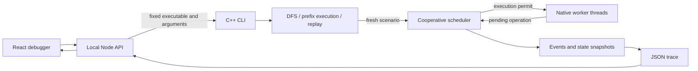

# ThreadScope — Deterministic Concurrency Debugger

ThreadScope explores execution orders in small, instrumented C++20 programs.
Real worker threads run through a cooperative scheduler that records each
decision, shared-state change, and synchronization dependency. Failures can be
replayed and inspected in a React/TypeScript debugger.

**Determinism covers instrumented operations only.** Worker-local computation
must be bounded and deterministic. ThreadScope does not instrument arbitrary
binaries or model C++ weak-memory effects. Passing a bounded search does not
prove general correctness.


## Features

- Bounded depth-first exploration of runnable-thread choices, with fresh state
  for each execution.
- Structured JSON traces and strict replay, including runnable sets, operations,
  observations, shared state, lock ownership, and wait-for dependencies.
- **What-If Schedule Explorer:** change an enabled choice, execute the preserved
  prefix from fresh state, and compare the original and modified traces.
- **Patch & Verify:** explore broken and corrected counter/lock implementations
  under identical bounds and replay failures in their original program.
- Interactive thread timelines, step navigation, state inspection, and explicit
  incomplete-search and divergence reporting.

## Build and run

Requirements: CMake 3.20+, a C++20 compiler, and native thread support. The JSON
dependency is vendored. The web debugger requires Node 22.12+ and npm; benchmarks
require Python 3.9+.

```sh
cmake -S . -B build -DCMAKE_BUILD_TYPE=Debug
cmake --build build --parallel 4
ctest --test-dir build --output-on-failure
cd web
npm ci
npm run build
npm test
npm start
```

Open [localhost:4318](http://127.0.0.1:4318). For development, run `npm run dev`
instead and open [localhost:5173](http://127.0.0.1:5173). The API uses the fixed
`build/threadscope` executable, binds to localhost, validates scenario names and
bounds, and starts child processes without a shell.

## CLI

Run these commands separately; an assertion failure or deadlock returns exit 1.

```sh
./build/threadscope explore lost-update --max-schedules 100 --max-steps 8 --out artifacts/counter
./build/threadscope replay artifacts/counter/failure-1.json
./build/threadscope branch artifacts/counter/failure-1.json --step 1 --thread 0 --trace artifacts/modified.json
./build/threadscope replay artifacts/modified.json
./build/threadscope explore lost-update-rmw --max-schedules 100 --max-steps 8
./build/threadscope explore mutex-deadlock --max-schedules 100 --max-steps 8
./build/threadscope explore mutex-ordered --max-schedules 100 --max-steps 8
```

`run --schedule 0,1,0,1` supplies a prefix; the suffix selects the lowest runnable
ID. Replay requires an exact match and reports divergence rather than falling
back to a different choice. `--all-traces` also saves passing schedules. Use a
fresh output directory to avoid retaining files from an older search.

Exit codes: **0** completed/no failures, **1** assertion/deadlock, **2** invalid
input, divergence, environmental error, or incomplete search. A verified replay
of a failure retains exit 1. Schedule limits count executions; step limits count
controlled operations per execution.

## Quick demo

With the server running:

1. Open **Patch & Verify**, select Lost-update counter, and click **Compare
   implementations**. The default bounds produce 6 broken schedules with
   4 assertions, compared with 2 corrected schedules with no failures.
2. Click **Replay broken failure**, then **Inspect broken trace**. Select the
   thread-1 `load` at decision 1, choose **T0**, and click **Run what-if**.
3. Select **Final outcomes**: the original counter is 1; the modified execution
   passes with 2. Both traces have independent replay results.
4. Compare Lock-order deadlock: opposite acquisition order produces 2 deadlocks
   in 6 schedules; consistent ordering completes 2 schedules without a deadlock.


## Architecture



The driver waits for every worker to submit its next operation or terminate
before choosing. One worker receives a permit; the next choice waits for
quiescence again. Request arrival order is not a scheduling input. Shared values
use real atomics, and modeled locks park unavailable requests without blocking
inside native application mutexes.

See [architecture and API](docs/architecture.md) and [trace format](docs/trace-format.md).

## Tests and measurements

Strict warnings are enabled by default: `-Wall -Wextra -Wpedantic -Wconversion
-Wshadow -Werror`. Tests cover scheduler lifecycle, arrival-order independence,
bounded enumeration against an independent state model, invalid traces, replay,
lock dependencies, API validation, and navigation.

Recorded local results on macOS arm64 / AppleClang 17: all 8 CTest suites passed
in Debug, Release, and standalone UBSan; 69 frontend/API tests and the production
build passed. ASan and TSan builds compiled, but local runtime probes timed out
or crashed, including an independent atomic/thread smoke program. Full ASan/TSan
scans remain unverified. Cross-platform CI is configured; local results do not
establish its status.

The [recorded Release benchmark](docs/benchmarks/macos-arm64.json) ran 10 searches
per scenario with 100-schedule / 8-step bounds:

| Scenario | Schedules/search | Assertions | Deadlocks | Median search time |
| --- | ---: | ---: | ---: | ---: |
| `lost-update` | 6 | 4 | 0 | 0.734 ms |
| `lost-update-rmw` | 2 | 0 | 0 | 0.174 ms |
| `mutex-deadlock` | 6 | 0 | 2 | 0.598 ms |
| `mutex-ordered` | 2 | 0 | 0 | 0.223 ms |

Across 160 executions, both seeded fault classes were found and 300/300
failing-trace replay attempts verified. A single controlled corrected-counter
run measured 78.750 µs median versus 40.375 µs for the three-native-thread
baseline: 1.950× runtime. These small-workload measurements include thread
startup; search timing excludes JSON encoding and disk writes.

```sh
cmake -S . -B build-release -DCMAKE_BUILD_TYPE=Release
cmake --build build-release --parallel 4
python3 scripts/benchmark.py --build-dir build-release --output artifacts/benchmark.json
```

See [benchmark methodology](docs/benchmark.md) for the measured environment,
baseline, warmups, raw results, and limits. Separate sanitizer configurations
use `-DTHREADSCOPE_SANITIZER=address`, `undefined`, or `thread` in their own build
directories. `scripts/verify_sanitizer.py --build-dir DIR --report FILE` runs
bounded startup probes and runs CTest only when they succeed.

## Limitations

Exploration grows combinatorially and retains full histories. There is no
partial-order reduction, fairness guarantee, arbitrary instrumentation, dynamic
thread creation, native condition-variable model, or weak-memory analysis.
Different implementations have different scheduling trees even with equal bounds.

Deadlines cancel framework waiters cooperatively; uncooperative native code can
prevent library worker cleanup. The local API adds a child-process watchdog.
Custom factories must reset all state, and contexts/resources must outlive their
run. Traces have versioned program names but no executable fingerprint. File
saves validate before overwrite but are not transactional against disk errors.

## Layout

```text
include/threadscope/   Public C++ APIs
src/                   Scheduler, exploration, trace codec, CLI
examples/              Broken and corrected instrumented programs
tests/                 C++, CLI, lifecycle, and benchmark regressions
tools/                 C++ measurement harness
scripts/               Benchmark and sanitizer runners
web/                   React UI, local API, shared parsers, tests
docs/                  Architecture, trace schema, benchmarks, screenshots
third_party/           Vendored JSON header and license
```
